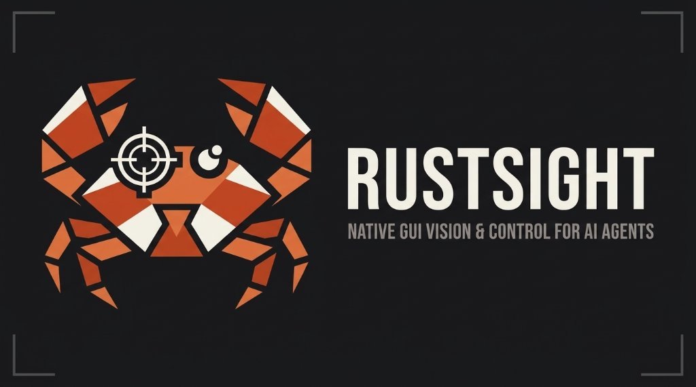
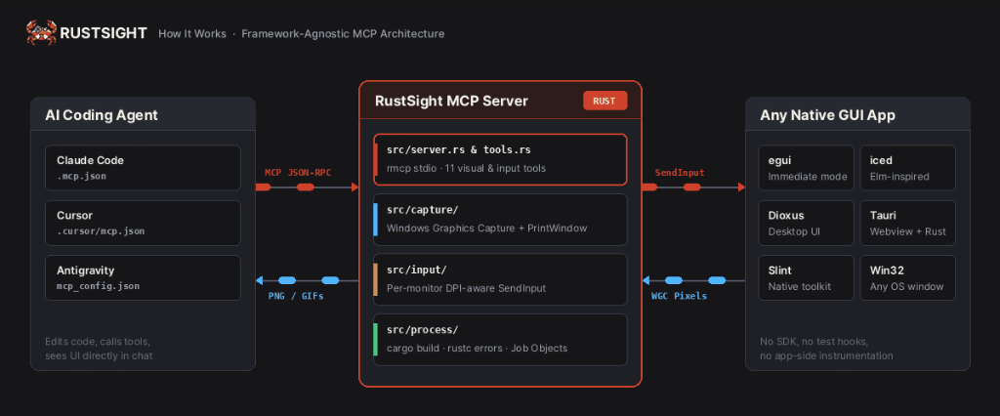

<p align="center">
  
</p>

<p align="center">
  <a href="https://github.com/p4han/RustSight/actions/workflows/ci.yml"></a>
  <a href="LICENSE"></a>
  <a href="https://www.rust-lang.org"></a>
</p>

**A framework-agnostic Rust MCP server that lets AI coding agents see and control any native GUI app directly in chat.**

## Install

Point your AI coding agent (Claude Code, Cursor, Antigravity, etc.) at this repository and ask:

> *"Install the RustSight skill & MCP server from https://github.com/p4han/RustSight"*

Your agent will follow [SKILL.md](SKILL.md) to install the `rustsight` binary and register the MCP server automatically.

Or install manually with Cargo:

```powershell
cargo install --git https://github.com/p4han/RustSight rustsight
```

This installs the `rustsight` MCP server binary onto your Cargo `PATH` (`%USERPROFILE%\.cargo\bin\rustsight.exe`).

## Quick Start

### Claude Code

```powershell
claude mcp add rustsight -- rustsight
```

### Cursor

Add to `.cursor/mcp.json` (or global `~/.cursor/mcp.json`):

```json
{
  "mcpServers": {
    "rustsight": {
      "command": "rustsight",
      "args": []
    }
  }
}
```

### Antigravity

Add to your Antigravity MCP settings (`mcp_config.json`):

```json
{
  "mcpServers": {
    "rustsight": {
      "command": "rustsight",
      "args": []
    }
  }
}
```

> **Note:** If `rustsight` is not on your `PATH`, replace `"rustsight"` with the full path to `rustsight.exe` (for example, `"C:\\Users\\you\\.cargo\\bin\\rustsight.exe"`).

## Features

- **Framework-agnostic**: Works with `egui`, `iced`, `Dioxus` desktop, `Tauri`, `Slint`, or any native Windows GUI window — no app-side instrumentation required.
- **Covers & DPI-aware**: Uses the Windows Graphics Capture API (with `PrintWindow` fallback) so windows are captured cleanly even when partially covered. Input coordinates use the pixels of the most recent full-window screenshot returned to the agent and map consistently to the window's client-area origin across DPI scales (downscaling above `--max-image-width` is scaled back automatically; pass `--max-image-width 0` for 1:1 physical pixels).
- **Visual feedback loop**: Every action (`click`, `type_text`, `press_key`, `scroll`, `drag`) waits for the UI to settle and automatically returns a fresh PNG screenshot.
- **Animation inspection**: `capture_frames` burst-captures frames, returns up to 12 evenly spaced PNGs in chat, and saves an animated GIF to disk.
- **Fast edit-compile-preview loop**: `launch` and `rebuild` run `cargo build`, return full `rustc` compiler diagnostics on failure, and automatically clean up child processes on exit.

## Tools

| Tool | Description |
| --- | --- |
| `launch(path_or_cargo_dir, args?, width?, height?)` | Build (if Cargo project) and launch the app, returning `window_id` + first screenshot. |
| `screenshot(window_id?)` | Capture a PNG screenshot of the window. |
| `capture_frames(window_id?, duration_ms=1500, fps=10)` | Burst-capture frames, returning up to 12 PNGs + an animated GIF path on disk. |
| `click(x, y, button?, double?, window_id?)` | Click at window-relative pixel `(x, y)` and return a fresh screenshot. |
| `type_text(text, window_id?)` | Type Unicode text into the window and return a fresh screenshot. |
| `press_key(key, modifiers?, window_id?)` | Press a key with optional modifiers (`ctrl`, `alt`, `shift`, `win`) and return a fresh screenshot. |
| `scroll(x, y, dx?, dy?, window_id?)` | Scroll at `(x, y)` and return a fresh screenshot. |
| `drag(from_x, from_y, to_x, to_y, window_id?)` | Drag from `(from_x, from_y)` to `(to_x, to_y)` and return a fresh screenshot. |
| `wait_idle(timeout_ms?, window_id?)` | Wait until consecutive frames stop changing, then return a fresh screenshot. |
| `rebuild()` | Kill the current app, run `cargo build`, relaunch, and return a fresh screenshot. |
| `close(window_id?)` | Close the tracked window and terminate its process. |

## CLI Flags

- `--settle-ms <MS>` (default: `120`) — Wait time after input actions before taking a screenshot.
- `--capture-dir <PATH>` — Directory for saving animated GIFs from `capture_frames` (defaults to OS temp dir).
- `--default-width <PX>` / `--default-height <PX>` — Default window size on `launch`.
- `--build-timeout-secs <SECS>` (default: `300`) — Timeout for `cargo build`.
- `--max-image-width <PX>` (default: `1920`) — Max width of screenshots returned to the MCP client (`0` disables downscaling).
- `--default-max-frames <N>` (default: `3`) — Default max frames returned in chat by `capture_frames`.
- `--allow-attach` (default: `false`) — Permit `list_windows` and tools to attach to any visible window on the machine, not just apps launched by RustSight.
- `--allow-process <NAME>` (repeatable, case-insensitive) — Permit attaching only to windows belonging to specific executable file names (for example, `--allow-process notepad.exe`), without enabling full `--allow-attach`.
- `--log-level <LEVEL>` (default: `info`) — Tracing log level (written to `stderr`).

## Security

By default, RustSight restricts all vision and input tools (`list_windows`, `screenshot`, `capture_frames`, `click`, `type_text`, `press_key`, `scroll`, `drag`, `wait_idle`, and `close`) to windows belonging to processes launched by RustSight in the current session (including their child processes). This prevents an agent from screenshotting or sending input to unrelated apps such as password managers, browsers, or chat clients. To attach to existing windows, explicitly opt in with `--allow-process <NAME>` or `--allow-attach`.

## Architecture



- `src/backend.rs` — Platform-agnostic `WindowCaptureBackend` and `InputBackend` traits (ready for macOS/Linux backends).
- `src/capture/` — Windows Graphics Capture API + `PrintWindow` fallback, PNG/GIF encoding, and frame diffing.
- `src/input/` — DPI-aware `SendInput` mouse, keyboard, scroll, and drag injection with `PostMessageW` fallback.
- `src/process/` — Cargo builder (`--message-format=json`), executable discovery, Windows Job Object lifecycle cleanup.
- `src/server.rs` & `src/tools.rs` — `rmcp` stdio MCP server and tool schemas.

## Troubleshooting

- **Clicks or keystrokes not landing**: RustSight tries OS-level `SendInput` first. If `SendInput` is blocked by Windows UIPI (e.g., an elevated window is focused or the desktop is locked/disconnected), it falls back to `PostMessageW` directly to the target `HWND`. Ensure the target app is not running elevated (as Administrator) unless `rustsight` is also elevated, and that coordinates are relative to the captured screenshot.
- **Window focus failures**: Before sending `SendInput`, RustSight verifies with `GetForegroundWindow()` that the target window (or its root/owner) is actually in front, retrying with `AttachThreadInput` and a brief `Alt` tap if Windows refuses `SetForegroundWindow`. If focus still cannot be acquired (e.g., an elevated window holds focus or the desktop is locked), `SendInput` is skipped so input never leaks into your editor or terminal—RustSight either uses the `PostMessageW` fallback or returns a `FocusFailed` error.
- **Build failures on `launch` or `rebuild`**: If `cargo build` fails, RustSight returns the full `rustc` stderr diagnostics directly to the agent as an actionable error message so the agent can fix the code and call `rebuild()` again.
- **DPI scaling & downscaling**: RustSight enables per-monitor DPI awareness (`DPI_AWARENESS_CONTEXT_PER_MONITOR_AWARE_V2`) and aligns the captured client area (`GetClientRect` + `ClientToScreen`) with input injection across 100%, 125%, 150%, and 200% scaling displays. Screenshots wider than `--max-image-width` (default `1920`) are downscaled to save tokens, and `click`/`scroll`/`drag` automatically scale screenshot coordinates back to physical client pixels (`scale = capture_width / max_image_width`). Pass `--max-image-width 0` to disable downscaling and get 1:1 physical pixels.

## License

MIT — see [LICENSE](LICENSE).
